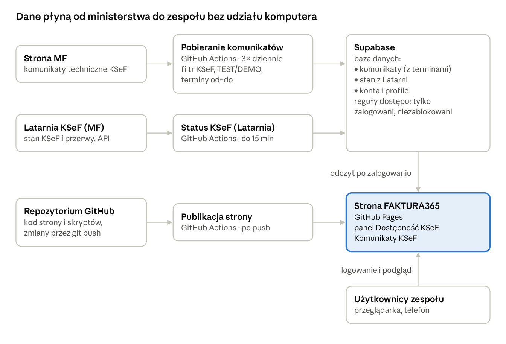

# Panel KSeF – opis projektu

25.10.2026 · Ola

Wersja do edycji i komentowania: [Claude Docs](https://claude.ai/artifact/FmQzBbTkJgv7gVasTVmco1) · Plany rozwoju: [rekomendacje do dalszej pracy](rekomendacje.md)

## Cel i dostęp

Panel KSeF zbiera w jednym miejscu komunikaty techniczne Ministerstwa Finansów o KSeF i bieżący stan dostępności KSeF, w wyglądzie aplikacji FAKTURA365.

- **Adres:** [olagorska513.github.io/panel-ksef](https://olagorska513.github.io/panel-ksef/)
- **Kto ma dostęp:** każda osoba z linkiem, po samodzielnym założeniu konta (e-mail i hasło). Konto działa od razu, bez zatwierdzania.
- **Administrator:** pierwsze założone konto. Widzi listę użytkowników i może blokować konta.
- **Źródła danych:** [komunikaty techniczne KSeF](https://ksef.podatki.gov.pl/komunikaty-techniczne/) oraz [Latarnia KSeF](https://github.com/CIRFMF/ksef-latarnia) Ministerstwa Finansów.

## Instrukcja dla użytkownika

Na stronie głównej panel „Dostępność KSeF” mówi, czy KSeF działa i czy zapowiedziano przerwy; szczegóły komunikatów są w Dashboard → Komunikaty KSeF.

1. **Rejestracja:** otwórz link, kliknij „Zarejestruj się”, podaj e-mail i hasło (co najmniej 8 znaków).
2. **Strona główna:** napis FAKTURA365 i panel „Dostępność KSeF”:
   - zielony pasek – „KSeF działa”,
   - żółty – trwa planowana przerwa albo zapowiedziane utrudnienia,
   - czerwony – awaria lub awaria całkowita KSeF,
   - lista przerw z terminem od–do i znacznikiem „Za 3 dni”, „Jutro”, „Dziś” lub „Trwa teraz”,
   - gdy nic nie zapowiedziano: „Brak nowych komunikatów o dostępności KSeF”.
3. **Chmurka „Jak czytać?”** (ikona latarni w rogu panelu): po najechaniu myszką lub stuknięciu pokazuje, jak czytać panel przed przerwą, w trakcie i po niej.
4. **Dashboard → Komunikaty KSeF:** podsumowanie (ostatnie sprawdzenie, liczba z 30 dni, najnowszy), wyszukiwarka, przełącznik Wszystkie / Produkcyjne / TEST i DEMO oraz przycisk „Kopiuj” przy treści każdego komunikatu.
5. **Dzwonek** na górnym pasku pokazuje liczbę komunikatów z ostatnich 7 dni.
6. **Konto:** kółko z inicjałami → „Zmień hasło” lub „Wyloguj”.

**Tryb offline.** Gdy KSeF jest niedostępny, panel pokazuje „KSeF jest teraz niedostępny – wystawiaj faktury w trybie offline”. Po przywróceniu działania faktury trzeba przesłać do KSeF:

| Zdarzenie | Termin przesłania faktur |
| --- | --- |
| Planowana przerwa | do końca następnego dnia roboczego po jej zakończeniu |
| Awaria | w ciągu 7 dni roboczych od jej zakończenia |
| Awaria całkowita | faktur nie trzeba przesyłać do KSeF |

Terminy według [dokumentacji Latarni MF](https://github.com/CIRFMF/ksef-latarnia/blob/main/scenariusze.md); przed przekazaniem klientom warto je potwierdzić.

## Jak to działa

Trzy zadania GitHub Actions zbierają dane z ministerstwa do bazy Supabase, a strona na GitHub Pages pokazuje je zalogowanym użytkownikom.

GitHub zapisuje dane w bazie, przeglądarka czyta je dopiero po zalogowaniu; kod trafia na stronę po każdym `git push`.

- **Filtr KSeF:** zapisywane są tylko komunikaty z „KSeF”, „Krajowy System e-Faktur” lub „Moduł Certyfikatów i Uprawnień” w tytule lub treści.
- **TEST / DEMO:** komunikat jest testowy, gdy dotyczy środowiska testowego lub przedprodukcyjnego i nie wspomina produkcji.
- **Terminy od–do:** odczytywane z treści, np. „16 października 2026 r. od godz. 22:00 do 17 października 2026 r. do godz. 3:00”; na obecnych danych w 54 z 93 komunikatów.
- **Latarnia:** strona nie może pytać jej bezpośrednio z przeglądarki (brak zgody serwera, CORS), dlatego robi to GitHub co 15 minut.

## Jak powstał panel

Projekt przeszedł od skryptu na jednym komputerze do strony dla całego zespołu w 24–25.10.2026, w dziewięciu krokach.

1. **Rozpoznanie źródła.** Strona ministerstwa ma pełną treść komunikatów w kodzie strony, więc da się ją czytać automatycznie; RSS ani API nie ma.
2. **Automat lokalny.** Skrypt PowerShell w Harmonogramie zadań Windows (7:00, 12:00, 16:00) zapisywał nowe komunikaty do pliku tekstowego. Wyłączony 25.10.2026.
3. **Panel lokalny.** Aplikacja Node.js z logowaniem pod localhost – działała tylko na jednym komputerze. Usunięta 25.10.2026.
4. **GitHub.** Publiczne repozytorium, strona na GitHub Pages, pobieranie komunikatów przez GitHub Actions – komputer nie musi być włączony.
5. **Supabase.** Baza i konta użytkowników: samodzielna rejestracja, pierwsze konto administratorem, blokowanie kont.
6. **Tylko KSeF.** Filtr zostawia komunikaty ze słowami „KSeF”, „Krajowy System e-Faktur” lub „Moduł Certyfikatów i Uprawnień” (89 z 93).
7. **TEST i DEMO.** Przełącznik środowisk; komunikat o produkcji i testach naraz liczy się jako produkcyjny.
8. **Wygląd FAKTURA365.** Menu boczne, Komunikaty KSeF w grupie Dashboard, Użytkownicy w Administracji, na stronie głównej tylko napis i panel dostępności.
9. **Latarnia i terminy przerw.** Stan KSeF z Latarni MF co 15 minut, terminy od–do wyciągane z treści komunikatów, chmurka „Jak czytać?” z przypomnieniem o trybie offline.

## Administracja i utrzymanie

Panel działa sam; administrator reaguje tylko na sprawy z tabeli poniżej.

| Sytuacja | Co zrobić |
| --- | --- |
| Na liście użytkowników jest ktoś nieznany | Administracja → Użytkownicy → „Zablokuj” |
| Ktoś zapomniał hasła | Supabase → Authentication → Users: usuń konto; osoba rejestruje się ponownie |
| Trzeba sprawdzić komunikaty natychmiast | GitHub → Actions → „Pobieranie komunikatów” → Run workflow |
| E-mail z GitHuba o wyłączeniu zadań (60 dni bez zmian) | GitHub → Actions → włącz zadania jednym kliknięciem |
| Zadanie „Pobieranie komunikatów” na czerwono | Strona ministerstwa mogła się zmienić – skopiować treść błędu z logu zadania i poprawić odczyt |
| Panel pokazuje „dane mogą być nieaktualne” | Sprawdzić zadanie „Status KSeF (Latarnia)” w Actions |

**Gdzie co jest**

| Element | Miejsce |
| --- | --- |
| Kod | GitHub [olagorska513/panel-ksef](https://github.com/olagorska513/panel-ksef) |
| Baza i konta | Supabase, projekt `hkswhfihnkcuhrvysvyl` |
| Sekrety GitHuba | `SUPABASE_URL`, `SUPABASE_SECRET_KEY` (Settings → Secrets and variables → Actions) |
| Schemat bazy | `supabase/schemat.sql` – można uruchamiać ponownie, niczego nie kasuje |

**Wprowadzanie zmian:** zmiana w kodzie → commit → `git push`; strona publikuje się sama w 1–2 minuty. Zmiana bazy → uruchomienie `schemat.sql` w Supabase SQL Editor *przed* wysłaniem kodu.

## Ograniczenia i ryzyka

Największe ryzyko to zależność od wyglądu strony ministerstwa i od darmowych planów GitHuba i Supabase.

- **Dostęp przez link:** kto zdobędzie link, może założyć konto; administrator może je zablokować.
- **Brak resetu hasła e-mailem:** wbudowana poczta Supabase nie wysyła wiadomości do osób spoza zespołu projektu; rozwiązaniem byłby własny serwer poczty (SMTP).
- **Zmiana strony ministerstwa** może zatrzymać pobieranie komunikatów, aż odczyt zostanie poprawiony.
- **Latarnia nie widzi wszystkiego:** według [portalu PIT](https://www.pit.pl/aktualnosci/miala-ostrzegac-przed-awariami-a-milczy-jak-zakleta-ministerialna-latarnia-ksef-to-atrapa) nie pokazała utrudnień z 16–17.10.2026; dlatego panel łączy ją z terminami z komunikatów MF.
- **Opóźnienia:** stan z Latarni trafia do panelu do kilkunastu minut po publikacji (zadanie co 15 minut, strona odświeża dane co 5 minut).
- **Terminy bez godzin:** komunikaty typu „25 września występują utrudnienia” nie mają godzin od–do; panel pokazuje je tylko przez dobę od publikacji.
- **Darmowe plany:** GitHub wyłącza zaplanowane zadania po 60 dniach bez zmian w repozytorium; Supabase wstrzymuje projekt po tygodniu bez aktywności (pobieranie co 15 minut temu zapobiega).
- **Wygląd FAKTURA365:** pozycje menu inne niż Komunikaty KSeF i Użytkownicy są tylko poglądowe.
